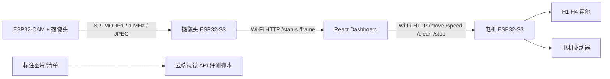

# catLitterTray 项目 AI 交接文档

> 最后更新：2026-08-14（Asia/Shanghai）
>
> 面向对象：后续接手本仓库的 AI、固件工程师、前端工程师和测试人员
> 代码基线：Dashboard、三套固件和云端视觉评测工具已统一整理进仓库

## 1. 项目目标与当前边界

本项目是智能猫砂盆原型，当前由三块控制板、一个本地 Web Dashboard 和一套独立的云端视觉模型评测工具组成：

1. **ESP32-CAM**：采集摄像头图像，通过 SPI 发送给摄像头网关 S3。
2. **摄像头 ESP32-S3**：作为 SPI 从机接收 JPEG，通过 Wi-Fi 提供 HTTP 图像与传感器状态接口。
3. **电机 ESP32-S3**：读取四路霍尔、驱动滚筒电机，并提供定位、调速、一键清理和紧急停止接口。
4. **React Dashboard**：在电脑浏览器中分别连接两块 S3，显示图像与状态并控制电机。
5. **视觉评测工具**：离线/云端评测 Qwen、GLM 等视觉 API，不在 ESP32 上运行模型。

当前明确决定：**ESP32-S3 不运行本地 TFLite 模型**。设备端唯一图像链路是 JPEG 中继；云端视觉评测与硬件实时控制暂未打通。

## 2. 硬件与数据流



两块 S3 和运行 Dashboard 的电脑必须连接同一个 2.4 GHz 局域网。当前两个 S3 固件均硬编码连接开放网络：

```cpp
WIFI_SSID = "TP-LINK_FA80"
WIFI_PASSWORD = ""
```

DHCP 地址可能在重启后变化，必须以各自串口输出为准。

## 3. 仓库结构

```text
catLitterTray/
├── AGENTS.md                         # 工作区安全规则：删除前必须移入废纸篓
├── AI_HANDOFF.md                     # 本交接文档
├── README.md                         # 项目入口
├── firmware/
│   ├── esp32-cam-video/              # ESP32-CAM 图像采集与 SPI 发送
│   ├── esp32-s3-main/                # 第一块 S3：摄像头 HTTP 网关
│   └── esp32-s3-motor-homing/        # 第二块 S3：霍尔、电机和清理流程
├── cat-litter-dashboard/             # React + TypeScript + Vite Dashboard
├── cat_vision_benchmark.py           # 统一视觉 API 评测入口
├── poop_vision_benchmark.py          # 粪便四分类评测
├── oxford_pet_api_eval.py            # Oxford-IIIT Pet 相关评测
├── benchmark_vision_apis.py           # 较早的视觉接口评测脚本
├── generate_full_vision_report.py    # 生成完整评测报告
├── tools/export_vision_report_pdf.py # 报告 PDF 导出
├── vision_providers*.json            # 模型供应商配置
├── vision_manifest.example.jsonl     # 数据清单示例
└── docs/
    ├── esp32-s3-camera-ai-migration.md
    ├── cloud-vision-benchmark.md
    ├── vision-benchmark-results-*.md/.pdf
    ├── poop-vision-benchmark-results-2026-08-11.md
    └── cat_litter_*.c                # 原产品固件逆向/教学伪代码，不是当前可烧录固件
```

`firmware` 中出现三个目录是正常的：一块 ESP32-CAM，加两块 ESP32-S3。

## 4. 固件 A：ESP32-CAM 图像发送端

文件：`firmware/esp32-cam-video/esp32-cam-video.ino`

### 4.1 主要配置

- Arduino 板型：`AI Thinker ESP32-CAM` / FQBN `esp32:esp32:esp32cam`
- 摄像头输出：`PIXFORMAT_JPEG`
- 分辨率：`FRAMESIZE_QQVGA`（160×120）
- JPEG quality：12
- framebuffer：2 个，`CAMERA_GRAB_LATEST`
- SPI：VSPI、MODE1、1 MHz、MSB first
- 数据块：1024 字节
- 每帧发送后等待 150 ms

### 4.2 ESP32-CAM SPI 接线

| 信号 | ESP32-CAM | 摄像头 S3 |
| --- | ---: | ---: |
| SCLK | GPIO 14 | GPIO 12 |
| MOSI | GPIO 13 | GPIO 11 |
| CS | GPIO 15 | GPIO 13 |
| GND | GND | GND |

必须共地。MISO 未使用。

### 4.3 帧协议

每帧由多个独立 CS transaction 组成：

1. 6 字节帧头：`0xAA 0x55 + uint32 little-endian JPEG长度`
2. 后续 JPEG 数据：每块最多 1024 字节

摄像头端串口成功输出类似：

```text
CAM READY
SPI READY
JPEG SENT: 4821 bytes, 5 blocks
```

### 4.4 当前问题

- 旧版 RGB565 链路曾经实机传输成功，但浏览器画面颜色严重异常，因此已迁移到 JPEG。
- 迁移 JPEG 后实机曾出现连续 `CAPTURE FAIL`。代码能够编译，但 **JPEG 摄像头采集尚未确认实机恢复**。
- 下一位接手者应优先单独验证摄像头：检查摄像头型号、PSRAM、供电、排线、`fb_count=2` 是否导致内存/采集失败。可先尝试 `fb_count=1`，同时打印 `esp_camera_init` 的具体错误码和 PSRAM 状态。
- 不要在未验证前声称视频链路已完全可用。

## 5. 固件 B：摄像头 ESP32-S3 网关

文件：`firmware/esp32-s3-main/esp32-s3-main.ino`

### 5.1 责任

- SPI 从机接收 ESP32-CAM 发送的 JPEG。
- 检查帧头、长度上限以及 JPEG SOI/EOI（`FF D8 ... FF D9`）。
- 使用双缓冲和互斥锁在 FreeRTOS 接收任务与 HTTP 线程之间传递帧。
- 连接 `TP-LINK_FA80` 并在串口输出 IP。
- 提供摄像头帧、状态和预留控制接口。

### 5.2 引脚

| 功能 | GPIO |
| --- | ---: |
| 摄像头 MOSI | 11 |
| 摄像头 SCLK | 12 |
| 摄像头 CS | 13 |
| 旧电机 RPWM（目前不驱动） | 40 |
| 旧电机 LPWM（目前不驱动） | 41 |
| 旧霍尔 H1-H4 | 4/5/6/7 |
| 上/下红外 | 17/18 |
| 集便盆满载 | 21 |

GPIO 11/12/13 已被摄像头 SPI 占用，不得复用。电机和四路霍尔的实际控制现在属于第二块 S3；本固件中 GPIO 40/41 和 H1-H4 属于遗留定义，应在后续重构时去除或明确用途。

### 5.3 缓冲与线程

- JPEG 单帧上限：64 KiB
- SPI block：1024 字节
- 两个 64 KiB 帧缓冲，优先放 PSRAM，失败时尝试内部 RAM
- 一个 DMA block 缓冲和一个 6 字节 DMA header 缓冲
- `camera-rx` FreeRTOS 任务固定在 core 0

### 5.4 HTTP API

服务端口：80，允许跨域访问。

| 方法与路径 | 返回/行为 |
| --- | --- |
| `GET /` | 文本 `CatLitterTray camera gateway` |
| `GET /status` | JSON，包含摄像头计数、JPEG 字节数和部分传感器状态 |
| `GET /frame` | 最近一帧，Content-Type 为 `image/jpeg`；无帧时 503 |
| `GET /command?cmd=STOP` | 确保本固件中旧电机输出为低 |
| `GET /command?cmd=CLEAN|DUMP|FLAT` | 只记录命令，不驱动电机 |

串口联网成功时：

```text
WI-FI CONNECTED
ESP32-S3 IP: 192.168.1.x
Dashboard device address: http://192.168.1.x
HTTP CAMERA SERVER READY ON PORT 80
```

## 6. 固件 C：电机 ESP32-S3

文件：`firmware/esp32-s3-motor-homing/esp32-s3-motor-homing.ino`

这是当前实际控制滚筒的第二块 S3。

### 6.1 引脚与电平

| 功能 | GPIO | 说明 |
| --- | ---: | --- |
| H1 | 4 | `INPUT_PULLUP`，LOW 表示触发 |
| H2 | 5 | `INPUT_PULLUP`，LOW 表示触发 |
| H3 | 6 | `INPUT_PULLUP`，LOW 表示触发；当前原点 |
| H4 | 7 | `INPUT_PULLUP`，LOW 表示触发 |
| MOTOR_R_EN | 16 | 电机驱动右使能 |
| MOTOR_L_EN | 15 | 电机驱动左使能 |
| MOTOR_RPWM | 17 | 正向 PWM |
| MOTOR_LPWM | 18 | 反向 PWM |

PWM：5 kHz、8 bit。速度范围 30–255，默认 200。

### 6.2 手动定位

- 正向：`RPWM=speed`、`LPWM=0`
- 反向：`RPWM=0`、`LPWM=speed`
- 目标霍尔连续 LOW 30 ms 后停止
- 若目标在命令下发时已经 LOW，则不会启动电机
- 上电不会自动转动
- 定位期间每 500 ms 输出四路霍尔原始电平、目标、方向、时间和 PWM

### 6.3 一键清理流程

H3 是原点。只有 H3 当前为 LOW 时，`/clean` 才允许启动。

```text
初始 H3
  -> 反向定位 H2
  -> 停止 500 ms
  -> 正向定位 H4
  -> 停止 500 ms
  -> 反向定位 H3
  -> CLEAN_COMPLETE_AT_H3
```

紧急停止会停止电机并取消整个清理流程。手动定位命令也会取消自动清理状态。

### 6.4 重要安全决定

根据当前用户要求，**手动定位和清理步骤都没有自动超时**。如果霍尔损坏、接错或磁铁无法触发，电机会持续运转，直到网页 `/stop`、复位或断电。

后续 AI 不得悄悄恢复超时；若要增加超时、过流、堵转或看门狗保护，必须先与用户确认。测试期间必须保证网页紧急停止可用，并保留物理断电手段。

### 6.5 HTTP API

| 方法与路径 | 行为 |
| --- | --- |
| `GET /` | 文本 `CatLitterTray motor controller` |
| `GET /status` | 电机状态、方向、速度、清理步骤、H1-H4、RSSI |
| `GET /move?target=H1&direction=forward` | 定位到 H1-H4；方向为 `forward` 或 `reverse` |
| `GET /speed?value=200` | 设置 PWM 30–255；运行中立即生效 |
| `GET /clean` | 从 H3 启动固定清理流程；非 H3 或忙碌时返回 409 |
| `GET /stop` | 立即停止并取消清理 |

`/status` 示例：

```json
{
  "state": "REVERSE_TO_H2",
  "moving": true,
  "target": 2,
  "direction": "reverse",
  "speed": 200,
  "cleaning": true,
  "cleanStep": 0,
  "home": 3,
  "halls": [false, false, true, false],
  "rssi": -48
}
```

串口会打印：

```text
Motor ESP32-S3 IP: 192.168.1.x
[Command] 网页请求反向定位到 H2
[Diag:MOVING] state=REVERSE_TO_H2 moving=YES target=H2 ...
[Hall] H2 原始电平变化：HIGH -> LOW
[Motor] 到达 H2，电机已停止
```

## 7. Dashboard

目录：`cat-litter-dashboard/`

### 7.1 技术栈

- React 18
- TypeScript 5.6
- Vite 5
- ESLint 9
- 无后端、无数据库、无身份验证
- GitHub Dark 视觉主题

关键文件：

| 文件 | 用途 |
| --- | --- |
| `src/App.tsx` | 所有连接、轮询、视频绘制和电机控制逻辑 |
| `src/App.css` | 早期基础样式 |
| `src/App.polish.css` | 当前最终覆盖样式，统一 GitHub Dark 主题 |
| `src/index.css` | 全局基础样式 |

当前 CSS 是“基础样式 + polish 覆盖层”。如果继续大改 UI，建议合并两份 CSS，避免长期累积覆盖规则；合并时不要改变现有视觉和响应式行为。

### 7.2 连接与本地状态

Dashboard 分别连接两个 IP：

- 摄像头 S3：`localStorage.catLitterDeviceHost` 或 `VITE_ESP32_HOST`
- 电机 S3：`localStorage.catLitterMotorHost` 或 `VITE_MOTOR_ESP32_HOST`

用户可在网页顶部手动填写 IP。摄像头和电机状态各自每 250 ms 轮询一次。

### 7.3 视频

Dashboard 先读取摄像头 `/status`。只有帧计数变化时才请求 `/frame`，然后创建 JPEG Blob，通过浏览器原生图片解码器画到 Canvas。页面显示帧率、分辨率和最后画面时间。

### 7.4 电机控制

- 正向/反向定位选择
- H1-H4 手动定位按钮
- H3 明确标记为原点
- PWM 30–255 滑块，150 ms 防抖后调用 `/speed`
- 一键清理按钮和三步进度显示
- 紧急停止按钮
- 固件状态码转换为中文，例如 `CLEAN_COMPLETE_AT_H3 -> 清理完成`
- 当前霍尔、方向和 PWM 突出显示

### 7.5 当前主题

整体使用 GitHub Dark 色板：

| 角色 | 色值 |
| --- | --- |
| 页面背景 | `#0d1117` |
| 卡片/导航 | `#161b22` |
| 次级表面 | `#21262d` |
| 边框 | `#30363d` |
| 主文字 | `#f0f6fc` |
| 次文字 | `#8b949e` |
| 链接/信息 | `#58a6ff` |
| 成功 | `#3fb950` |
| 警告 | `#d29922` |
| 危险 | `#f85149` |

页面已支持桌面、平板和手机布局，也尊重 `prefers-reduced-motion`。

## 8. 本地启动、编译和烧录

### 8.1 Dashboard

```bash
cd cat-litter-dashboard
npm install
npm run dev
```

验证：

```bash
npm run build
npm run lint
```

当前 Dashboard 已通过 build 和 lint。

### 8.2 Arduino IDE

- Arduino IDE：2.3.10（实机截图环境）
- ESP32 Arduino Core：3.3.11
- 串口波特率：115200
- S3 使用板载 USB 转串口时：`USB CDC On Boot -> Disabled`

板型：

- ESP32-CAM：`AI Thinker ESP32-CAM`
- 两块 S3：`ESP32S3 Dev Module`

已使用的 CLI 验证 FQBN：

```text
ESP32-CAM:
esp32:esp32:esp32cam

ESP32-S3:
esp32:esp32:esp32s3:FlashSize=16M,PartitionScheme=app3M_fat9M_16MB,PSRAM=opi,CDCOnBoot=default
```

三个固件均曾使用 ESP32 Core 3.3.11 编译通过。实机烧录时必须确认选择了对应的物理串口，防止把电机固件写入摄像头 S3。

推荐启动顺序：

1. 摄像头 S3 上电，确认其进入 SPI 接收并联网。
2. ESP32-CAM 上电，观察是否开始输出 `JPEG SENT`。
3. 电机 S3 上电，确认所有霍尔状态和 IP。
4. 启动 Dashboard，分别填入两个 S3 的 IP。
5. 电机空载、低速测试手动定位，再测试一键清理。

## 9. 云端视觉模型评测

统一入口：`cat_vision_benchmark.py`

用途：使用 JSONL 清单和 OpenAI-compatible Chat Completions 接口，对以下字段进行评测：

- `has_cat`
- `has_cat_waste`
- `cat_breed`

脚本仅依赖 Python 标准库，支持并发、重试、断点续跑、结构化 JSON 检查、延迟/Token/费用统计。

密钥流程：复制 `vision-benchmark.env.example` 为 `.env.local`，填写供应商密钥；真实密钥不得提交。

重要报告：

- `docs/vision-benchmark-results-full-2026-08-11.md`：Oxford-IIIT Pet 7,349 张；Qwen 低延迟和接口稳定性更好，GLM 品种准确率/成本维度有优势，但公开宠物图不能代表猫砂盆现场。
- `docs/poop-vision-benchmark-results-2026-08-11.md`：307 张宠物粪便四分类；Qwen3.7-Plus 66.12%，GLM-4.6V 47.88%。
- `docs/vision-benchmark-results-2026-08-10.md`：24 张小样本复现说明。
- `docs/cloud-vision-benchmark.md`：团队运行指南。

这些结果是模型筛选证据，不是生产准确率承诺。仓库当前文件列表中没有完整 `datasets/`，复测前需要确认数据集是否在外部目录或未纳入版本控制。

## 10. 逆向伪代码资产

`docs/cat_litter_*.c` 是对其他猫砂盆原固件的逆向、注释和教学伪代码，包括 22 步清理状态机、传感器处理、OTA、液位、电磁阀、重量和 DP 映射等。

这些文件：

- 不是当前 ESP32 工程；
- 不能直接烧录；
- 部分符号和语义属于推断；
- 可作为未来安全状态机、猫防夹、清理流程和产品行为设计的参考。

不要把伪代码中的 GPIO、RAM 地址或状态编号直接复制到 ESP32 固件而不做硬件验证。

## 11. 已验证状态矩阵

| 模块 | 编译/构建 | 实机状态 |
| --- | --- | --- |
| ESP32-CAM RGB565 旧链路 | 已淘汰 | SPI 收发成功，但颜色错误 |
| ESP32-CAM JPEG 当前链路 | 编译通过 | 曾出现连续 `CAPTURE FAIL`，待修复 |
| 摄像头 S3 JPEG 网关 | 编译通过 | Wi-Fi/IP/HTTP 启动已实机确认；需配合 CAM 重测 JPEG |
| 电机 S3 手动定位 | 编译通过 | 网页可连接，正反转与超时现象曾实机观察；最新流程需继续实机验收 |
| 电机速度滑块 | 构建/编译通过 | 需确认运行中调速与驱动器响应 |
| 一键清理 | 构建/编译通过 | 最新顺序需实机完整跑通 |
| Dashboard | build/lint 通过 | 可连接电机；GitHub Dark 新布局需继续实机浏览器验收 |
| 云端视觉评测 | 已产生报告 | 与实时摄像头尚未集成 |

## 12. 已知风险与技术债

### P0：硬件安全

- 电机定位没有自动超时，霍尔故障会导致持续运转。
- 当前仅有软件紧急停止，尚未看到独立物理急停、过流、堵转、顶盖、抽屉或猫存在联锁。
- Wi-Fi 和 HTTP 无认证，局域网内任何客户端都可能调用电机接口。
- `TP-LINK_FA80` 是开放网络，安全性低。

### P1：摄像头

- JPEG `CAPTURE FAIL` 未解决。
- SPI 协议没有 CRC、序列号、ACK、重同步或超时；传输异常后可能丢帧或失步。
- 摄像头 S3 在发送 HTTP 帧时持有互斥锁，慢客户端可能增加丢帧。

### P1：架构

- 两块 S3 的 IP 依赖 DHCP，缺少 mDNS、静态 DHCP 或设备发现。
- Dashboard 直接跨域请求两个裸 HTTP 设备，部署到 HTTPS 后会遇到 mixed-content 限制，因此当前适合作为本地 HTTP Dashboard。
- 摄像头 S3 中仍保留旧电机/霍尔定义，职责不够干净。

### P2：代码维护

- Dashboard 的全部逻辑集中在单个 `App.tsx`。
- `App.css` 和 `App.polish.css` 存在覆盖关系，后续应重构成组件化样式。
- 固件缺少自动化单元测试；目前主要依赖编译和实机串口。
- 多个视觉配置、报告和输出目录尚未整理到一次明确提交。

## 13. 推荐下一步

按优先级执行：

1. **修复并单测 ESP32-CAM JPEG `CAPTURE FAIL`**，先脱离 SPI 验证连续取帧。
2. **空载验收电机流程**：H3 → 反向 H2 → 正向 H4 → 反向 H3，逐步核对串口和物理方向。
3. 增加独立物理急停、驱动过流/堵转保护和猫存在/顶盖联锁，再考虑长期运行。
4. 给两块 S3 配置稳定地址（路由器 DHCP reservation 或 mDNS）。
5. 清理摄像头 S3 中的旧电机职责，明确两块 S3 的传感器归属。
6. 将 Dashboard 拆分为 CameraPanel、MotorPanel、SensorPanel 和设备连接 hooks。
7. 设计摄像头抓拍上传到云端视觉服务的后端；不要把供应商 API Key 放在浏览器或 ESP32 固件中。
8. 用真实猫砂盆图像建立带猫、排泄物类型、遮挡、夜间、脏镜头真值的数据集，再做最终模型选型。
9. 整理工作区并创建可回滚的 Git 提交；提交前逐项审查未跟踪文件和密钥。

## 14. 接手检查清单

- [ ] 阅读 `AGENTS.md`，所有删除操作先移入 macOS 废纸篓。
- [ ] 不覆盖用户当前未提交修改。
- [ ] 执行 `git status --short --branch`，确认工作区状态。
- [ ] 确认三块板的串口和固件对应关系。
- [ ] 确认两块 S3 串口打印的实际 IP。
- [ ] 用 `/status` 单独测试摄像头 S3 和电机 S3。
- [ ] 电机测试前确认网页 `/stop` 和物理断电可用。
- [ ] 一键清理前确认 H3 为 LOW/TRIGGERED。
- [ ] 对摄像头问题先采集完整启动日志和错误码，不盲改 SPI。
- [ ] 前端修改后运行 `npm run build` 和 `npm run lint`。
- [ ] 固件修改后使用 ESP32 Arduino Core 3.3.11 编译，并在目标板实机验证。
- [ ] 不提交 `.env.local`、API Key 或其他凭据。

## 15. 对后续 AI 的直接说明

- 用户偏好：中文沟通、直接实现、只给一个明确方案。
- 用户明确要求：删除任何文件或目录前先移入废纸篓，不可直接永久删除。
- 不要重新引入 ESP32 本地 TFLite，除非用户明确改变需求。
- 不要把两块 S3 合并为一块；当前硬件明确是两块 ESP32-S3。
- 电机原点是 H3，不是 H4。
- 当前一键清理顺序必须保持：**H3 → 反向 H2 → 正向 H4 → 反向 H3**。
- 手动正向/反向定位功能都要保留。
- 电机速度必须能由网页在 PWM 30–255 范围内调节。
- Dashboard 整体主题必须保持 GitHub Dark 配色。
- 每次声称“可用”时区分“编译通过”和“实机验证通过”。
