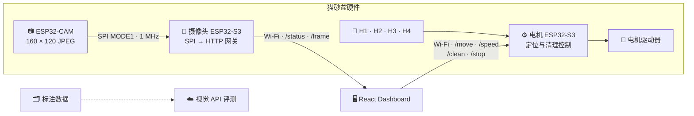
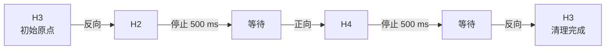

<div align="center">

# 🐈 Cat Litter Tray

### 基于 ESP32 的智能猫砂盆控制与视觉监控系统

三块控制板协同完成图像采集、实时监控、四点绝对定位、电机调速和自动清理。

[](firmware/)
[](cat-litter-dashboard/)
[](cat-litter-dashboard/)
[](cat-litter-dashboard/)
[](cat-litter-dashboard/src/App.polish.css)

[快速开始](#-快速开始) · [系统架构](#-系统架构) · [硬件与接线](#-硬件与接线) · [HTTP API](#-http-api) · [项目文档](#-项目文档)

</div>

---

## ✨ 项目概览

Cat Litter Tray 是一套正在实机开发的智能猫砂盆原型。系统把实时控制和视觉链路拆分到不同控制板，Dashboard 通过局域网分别连接两块 ESP32-S3。

| 模块 | 主要职责 | 当前状态 |
| --- | --- | --- |
| **ESP32-CAM** | OV3660 图像采集、JPEG 编码、SPI 发送 | ✅ 编译通过 · ⚠️ JPEG 实机采集待复测 |
| **摄像头 ESP32-S3** | SPI 接收、JPEG 双缓冲、HTTP 图像服务 | ✅ 编译通过 |
| **电机 ESP32-S3** | 四路霍尔、电机定位、PWM 调速、自动清理 | ✅ 编译通过 · ✅ 已进行网页联调 |
| **Web Dashboard** | 实时画面、状态监控、定位与清理控制 | ✅ Build / Lint 通过 |
| **视觉评测工具** | Qwen、GLM 等云端视觉模型离线评测 | ✅ 脚本与报告已归档 |

> [!IMPORTANT]
> “编译通过”不等于“完整实机验证通过”。摄像头 JPEG 链路仍需继续排查间歇性 `CAPTURE FAIL`。

## 🧭 系统架构



设备端不运行本地 TFLite 模型。当前图像链路固定为：

```text
摄像头 → 160×120 JPEG → SPI → 摄像头 S3 → HTTP → Dashboard
```

## 🧹 一键清理流程

H3 是滚筒原点。只有 H3 当前被触发时，自动清理才允许启动。



- 霍尔信号连续触发 30 ms 后停止电机。
- 网页可在 PWM `30–255` 范围内实时调速。
- 手动定位支持选择正向或反向。
- 紧急停止会立即停止电机并取消整个清理流程。

> [!WARNING]
> 当前定位流程根据项目要求没有自动超时。霍尔故障时电机可能持续运行，调试时必须保留网页紧急停止和物理断电手段。

## 🚀 快速开始

### 环境要求

- Node.js 20 LTS
- npm
- Git
- Chrome、Edge 或 Safari
- 两块 ESP32-S3 与运行网页的电脑处于同一局域网

### 运行 Dashboard

```bash
git clone https://github.com/Hack166/catLitterTray.git
cd catLitterTray/cat-litter-dashboard
npm ci
npm run dev
```

浏览器打开终端显示的地址，通常为：

```text
http://localhost:5173
```

随后在页面顶部填写两块 S3 串口输出的 IP：

1. **摄像头 S3**：提供画面和摄像头状态。
2. **电机 S3**：提供霍尔状态和电机控制。

当前固件默认连接开放 Wi-Fi `TP-LINK_FA80`。两块 S3 均会通过 115200 波特率串口输出自己的 DHCP 地址。

### 允许局域网其他设备访问

```bash
npm run dev -- --host 0.0.0.0
```

其他设备打开 `http://<运行网页的电脑IP>:5173`。如果无法访问，请允许防火墙中的 Node.js 入站连接，并确认路由器没有开启客户端隔离。

### 构建检查

```bash
npm run build
npm run lint
```

## 🔧 硬件与接线

### ESP32-CAM → 摄像头 ESP32-S3

| 信号 | ESP32-CAM | 摄像头 S3 |
| --- | ---: | ---: |
| SCLK | GPIO 14 | GPIO 12 |
| MOSI | GPIO 13 | GPIO 11 |
| CS | GPIO 15 | GPIO 13 |
| GND | GND | GND |

SPI 使用 MODE1、1 MHz、MSB First；MISO 未使用，两块板必须共地。

### 电机 ESP32-S3

| 功能 | GPIO | 说明 |
| --- | ---: | --- |
| H1 | 4 | `INPUT_PULLUP`，LOW 表示触发 |
| H2 | 5 | `INPUT_PULLUP`，LOW 表示触发 |
| H3 | 6 | 当前原点，LOW 表示触发 |
| H4 | 7 | `INPUT_PULLUP`，LOW 表示触发 |
| MOTOR_R_EN | 16 | 右使能 |
| MOTOR_L_EN | 15 | 左使能 |
| MOTOR_RPWM | 17 | 正向 PWM |
| MOTOR_LPWM | 18 | 反向 PWM |

完整引脚、帧协议和烧录设置见 [AI 交接文档](AI_HANDOFF.md)。

## 🌐 HTTP API

### 摄像头 S3

| 方法 | 路径 | 用途 |
| --- | --- | --- |
| `GET` | `/status` | 摄像头计数、JPEG 大小和传感器状态 |
| `GET` | `/frame` | 获取最近一帧 JPEG；无帧时返回 503 |
| `GET` | `/command?cmd=STOP` | 将摄像头 S3 中的遗留电机输出置低 |

### 电机 S3

| 方法 | 路径 | 用途 |
| --- | --- | --- |
| `GET` | `/status` | 电机、方向、PWM、清理步骤和 H1–H4 状态 |
| `GET` | `/move?target=H2&direction=reverse` | 按指定方向定位到 H1–H4 |
| `GET` | `/speed?value=200` | 设置 PWM 速度，范围 30–255 |
| `GET` | `/clean` | 从 H3 启动固定清理流程 |
| `GET` | `/stop` | 紧急停止并取消清理 |

## 📁 仓库结构

```text
catLitterTray/
├── firmware/
│   ├── esp32-cam-video/          # 摄像头采集与 SPI 发送
│   ├── esp32-s3-main/            # 摄像头 HTTP 网关
│   └── esp32-s3-motor-homing/    # 电机、霍尔与清理流程
├── cat-litter-dashboard/         # React + TypeScript + Vite
├── docs/                         # 迁移记录与视觉评测报告
├── tools/                        # 报告导出工具
├── cat_vision_benchmark.py       # 统一视觉 API 评测入口
├── vision_providers*.json        # 模型供应商配置示例
├── vision_manifest.example.jsonl # 数据清单示例
├── AI_HANDOFF.md                 # 完整开发交接文档
└── AGENTS.md                     # 工作区安全规则
```

`firmware/` 中有三个目录是正常的：一块 ESP32-CAM，加两块职责不同的 ESP32-S3。

## 📚 项目文档

| 文档 | 内容 |
| --- | --- |
| [AI_HANDOFF.md](AI_HANDOFF.md) | 硬件拓扑、固件职责、接口、风险和接手清单 |
| [Dashboard README](cat-litter-dashboard/README.md) | 网页启动及设备连接说明 |
| [摄像头方案迁移](docs/esp32-s3-camera-ai-migration.md) | RGB565 到 JPEG 的迁移记录 |
| [云端视觉评测](docs/cloud-vision-benchmark.md) | 模型配置与运行方式 |
| [全量视觉评测报告](docs/vision-benchmark-results-full-2026-08-11.md) | Oxford-IIIT Pet 全量结果 |
| [粪便四分类评测](docs/poop-vision-benchmark-results-2026-08-11.md) | Pet Poop Classifier 数据集结果 |

## 🧪 技术栈

| 领域 | 技术 |
| --- | --- |
| 嵌入式 | Arduino · ESP32 · FreeRTOS · SPI · Wi-Fi · HTTP |
| 前端 | React 18 · TypeScript 5.6 · Vite 5 · Canvas |
| UI | GitHub Dark 设计语言 · 响应式布局 |
| 视觉评测 | Python · Qwen Vision · GLM Vision |

---

<div align="center">

**从可靠的绝对定位开始，让猫砂盆控制变得可观察、可调试、可扩展。**

</div>
