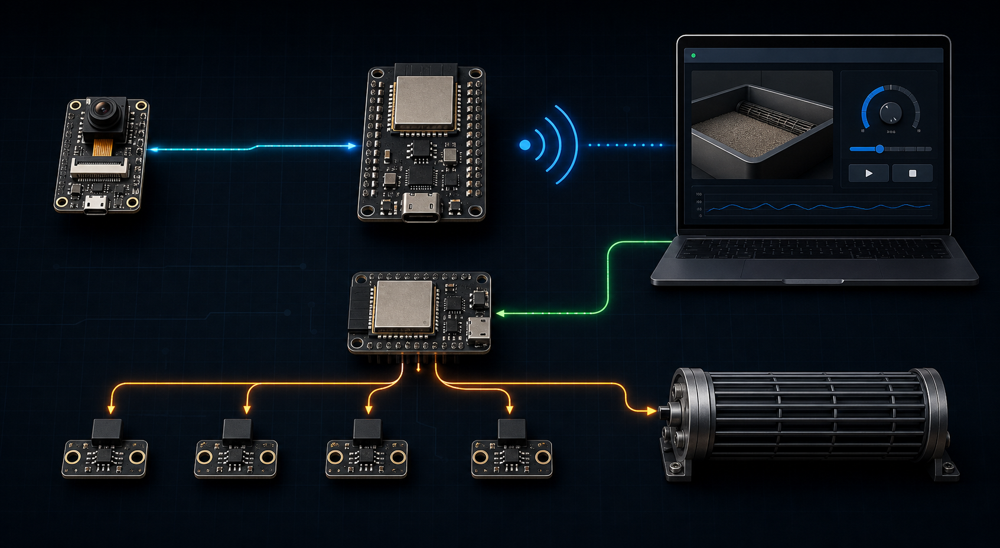

<div align="center">

# 🐈 Cat Litter Tray

### 基于 ESP32 的智能猫砂盆控制与视觉监控系统

用三块控制板连接摄像头、滚筒电机与 Web Dashboard，完成实时监控、四点定位、速度调节和自动清理。

[](firmware/)
[](cat-litter-dashboard/)
[](cat-litter-dashboard/)
[](cat-litter-dashboard/)

[项目介绍](#-项目介绍) · [系统组成](#-系统组成) · [快速开始](#-快速开始) · [项目结构](#-项目结构)

</div>

---

## ✨ 项目介绍

Cat Litter Tray 是一套智能猫砂盆原型系统。硬件端由一块 ESP32-CAM 和两块 ESP32-S3 组成，浏览器端提供 GitHub Dark 风格的控制面板。

### 核心能力

- 📷 实时摄像头画面
- 🧲 H1–H4 四路霍尔绝对定位
- ⚙️ 电机正反转与 PWM 速度调节
- 🧹 从 H3 原点启动一键清理
- 🛑 网页紧急停止
- 📱 桌面与移动端响应式 Dashboard

## 🧭 系统组成

<p align="center">
  
</p>

| 模块 | 作用 |
| --- | --- |
| **ESP32-CAM** | 采集图像并通过 SPI 发送 JPEG |
| **摄像头 ESP32-S3** | 接收图像，通过 Wi-Fi 提供画面与状态 |
| **电机 ESP32-S3** | 读取四路霍尔并控制滚筒电机 |
| **Web Dashboard** | 显示画面、设备状态并发送控制指令 |

```text
摄像头链路：ESP32-CAM → SPI → 摄像头 S3 → Wi-Fi → Dashboard
控制链路：Dashboard → Wi-Fi → 电机 S3 → 霍尔传感器 / 滚筒电机
```

## 🧹 清理流程

滚筒以 H3 为原点，一键清理按固定路线运行：


## 🚀 快速开始

### 准备

- Node.js 20 LTS
- Git
- 两块 ESP32-S3 与电脑连接同一局域网

### 启动 Dashboard

```bash
git clone https://github.com/Hack166/catLitterTray.git
cd catLitterTray/cat-litter-dashboard
npm ci
npm run dev
```

打开终端显示的地址，然后在网页中分别填写摄像头 S3 和电机 S3 的 IP。

如需让局域网内其他电脑或手机访问：

```bash
npm run dev -- --host 0.0.0.0
```

## 📁 项目结构

```text
catLitterTray/
├── firmware/
│   ├── esp32-cam-video/          # 摄像头采集端
│   ├── esp32-s3-main/            # 摄像头网络网关
│   └── esp32-s3-motor-homing/    # 电机与霍尔控制器
├── cat-litter-dashboard/         # React Web 控制面板
├── docs/                         # 项目文档与评测记录
├── tools/                        # 辅助工具
└── AI_HANDOFF.md                 # 完整开发交接文档
```

## 📚 更多资料

- [完整开发交接文档](AI_HANDOFF.md)
- [Dashboard 使用说明](cat-litter-dashboard/README.md)
- [摄像头方案记录](docs/esp32-s3-camera-ai-migration.md)
- [云端视觉评测说明](docs/cloud-vision-benchmark.md)

---

<div align="center">

**Hardware · Firmware · Dashboard**

</div>
